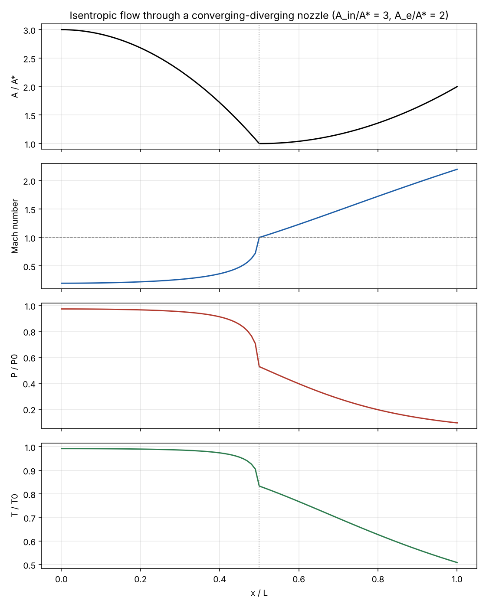
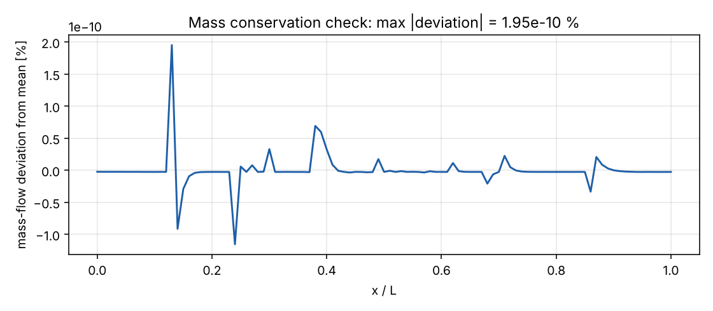

# Quasi-1D Compressible Nozzle Flow Solver

**Author:** Nakul Srivatsan  
**Date:** February–March 2026 (solver) · November 2026 (SolidWorks model, figures)  
**Language:** Python 3 (used Claude as a coding assistant) · NumPy · SciPy · Matplotlib

---

## Project Scope

This is my first project in my self-directed CFD portfolio built to teach and show the fundamentals and basic applications of computational fluid dynamics.

The goal was to build a physics-first solver from scratch, not using any CFD framework or copying a tutorial rather deriving the governing equations and implementing them, then validating against analytical theory, and comparing against known results.

The solver computes isentropic compressible flow through a user generated converging-diverging (de Laval) nozzle. Given reservoir conditions and a custom geometry, it outputs the full flow field: Mach number, pressure, temperature, density, and velocity at every point along the nozzle axis. Mass flow conservation is validated to better than 0.0001%.

---

## Physics Background

Physics background from PHY211/222 (Washtenaw Community College), supplemented by self-study of White's *Fluid Mechanics*, 7th Ed. (McGraw-Hill).

### Why a Converging-Diverging Nozzle?

A de Laval nozzle accelerates flow from subsonic to supersonic. This is counterintuitive: in everyday experience (subsonic flow), squeezing a pipe speeds up flow — that's Bernoulli. But at Mach 1, something breaks: the flow can no longer accelerate in a converging section. To go supersonic, the area must *increase* after the throat.

This is a direct consequence of the **area-velocity relation** for compressible flow:

```
dA/A = (M² - 1) · dV/V
```

- When M < 1: dA and dV have opposite signs → area decreases, velocity increases (subsonic intuition)
- When M > 1: dA and dV have the same sign → area must increase for velocity to increase (supersonic)
- When M = 1: dA = 0 → Mach 1 can only occur at a throat (area minimum)

### Governing Equations

All relations assume **isentropic flow** (adiabatic + no friction + no shocks). Stagnation conditions P₀ and T₀ remain constant throughout.

**Area-Mach Relation** (links geometry to Mach number):

```
A/A* = (1/M) · [ (2/(γ+1)) · (1 + (γ-1)/2 · M²) ]^((γ+1)/(2(γ-1)))
```

**Isentropic Pressure:**
```
P/P₀ = (1 + (γ-1)/2 · M²)^(-γ/(γ-1))
```

**Isentropic Temperature:**
```
T/T₀ = 1 / (1 + (γ-1)/2 · M²)
```

**Velocity:**
```
V = M · √(γRT)
```

**Mass Flow Conservation** (must hold at every cross-section):
```
ṁ = ρ · V · A = constant
```

---

## Features

- **User-defined geometry** — specify inlet area, throat area, exit area, and throat location interactively
- **Dual Mach branch solver** — correctly solves subsonic and supersonic branches of the area-Mach relation
- **Full flow field output** — M, P, T, ρ, V at every grid point
- **Mass flow validation** — checks conservation to < 0.1% with deviation plot
- **Interactive terminal interface** — input validation, error messages, re-run loop
- **Professional visualization** — nozzle geometry, velocity distribution, mass flow conservation plots

---

## How to Run

### Requirements
```bash
pip install numpy scipy matplotlib
```

### Run
```bash
python nozzle_solver.py
```

### Example Session
```
============================================================
CUSTOM NOZZLE FLOW SOLVER
============================================================

📐 DEFINE YOUR NOZZLE GEOMETRY
------------------------------------------------------------
Enter nozzle dimensions (or press Enter for defaults):
  Defaults: Inlet=3.0, Throat=1.0, Exit=2.5, Location=0.4

Inlet area [m²] (default 3.0): 
Throat area [m²] (default 1.0): 
Exit area [m²] (default 2.5): 
Throat location [0-1] (default 0.4): 

💨 DEFINE FLOW CONDITIONS
------------------------------------------------------------
Stagnation pressure P0 [Pa] (default 101325): 
Stagnation temperature T0 [K] (default 300): 
Back pressure P_back [Pa] (default 101325): 

🚀 Solving compressible flow...
✅ PASSED: Mass flow is conserved! (Variation < 0.0001%)
```

---

## Code Architecture

```
nozzle_solver.py
│
├── area_mach_relation()           # Root function for Brent solver
├── solve_mach_from_area()         # Solves A/A* → M (subsonic or supersonic)
├── isentropic_pressure()          # P from M via isentropic relation
├── isentropic_temperature()       # T from M via isentropic relation
├── compute_density()              # Ideal gas law: ρ = P/RT
├── compute_velocity()             # V = M · √(γRT)
│
├── create_custom_nozzle()         # Builds user-defined nozzle geometry function
├── solve_nozzle_flow()            # Main solver: loops over grid, calls all above
│
├── plot_nozzle_and_velocity()     # Geometry + velocity plots
├── check_mass_flow_conservation() # Validation plot + pass/fail report
│
└── main block                     # Interactive terminal loop with input validation
```

---

## Results

Case shown: A_in/A* = 3, A_exit/A* = 2, throat at mid-length, P0 = 1 atm, T0 = 300 K, 101 grid points. Regenerate everything with `python make_figures.py`.



The flow accelerates through the converging section, reaches exactly Mach 1 at the throat, and keeps accelerating supersonically in the diverging section while pressure and temperature fall. The slope change at the throat comes from the geometry: the two parabolic sections meet with a kink in dA/dx (see Bug 2 and the SolidWorks notes below).

| Station | A/A* | M | P/P0 | T/T0 | P [Pa] | T [K] | V [m/s] |
|---|---|---|---|---|---|---|---|
| Inlet | 3.000 | 0.1974 | 0.9732 | 0.9923 | 98,608 | 297.7 | 68.3 |
| Throat | 1.000 | 1.0000 | 0.5283 | 0.8333 | 53,528 | 250.0 | 316.9 |
| Exit | 2.000 | 2.1972 | 0.0939 | 0.5088 | 9,518 | 152.6 | 544.1 |

These match the standard isentropic flow tables for γ = 1.4 (A/A* = 2 supersonic: M = 2.197, P/P0 = 0.0939).

### Validation



| Check | Result |
|---|---|
| Mass flow variation along the nozzle | 2 × 10⁻¹⁰ % (target: < 0.0001 %) |
| Solver mass flow vs. closed-form choked-flow formula | 236.4478 kg/s both, error ~10⁻¹² % |
| Area-Mach relation residual at the solved Mach numbers | 6 × 10⁻¹² |

What this does and does not show: the solver is algebraic (area-Mach relation plus isentropic relations at each station), so these checks confirm the root-finding picks the correct branch everywhere and the post-processing is consistent. It is not a test of a time-marching scheme. Shocks and back-pressure effects are not modeled yet (see What's Next).

---

## SolidWorks Model

Files: [`solidworks/quasi_nozzle.SLDPRT`](solidworks/quasi_nozzle.SLDPRT), [`solidworks/nozzle_profile_mm.txt`](solidworks/nozzle_profile_mm.txt)

The solver works in normalized areas, so I turned the same geometry into a physical part to connect the numerics to something I could measure.

- **Area to radius:** for a circular cross-section A = πr², so r(x) = r_t · √(A(x)/A*). With a 20 mm throat radius and 200 mm length, that gives 21 profile points (in the .txt file).
- **Build:** the points were imported as a curve, sketched as a spline, and revolved as a thin feature with a 3 mm wall.
- **Check against the solver:** measured inner diameters in SolidWorks are 69.28 mm (inlet), 40.00 mm (throat) and 56.57 mm (exit). Squaring the diameter ratios gives area ratios of 3.000 and 2.000, the solver inputs, to four significant figures.
- **Bug caught:** my first revolve thickened the wall inward, which shrank the flow passage and made every measured diameter wrong. The measurement check is what exposed it. The wall has to grow outward so the inner surface is the flow boundary.
- **Throat kink:** the parabolic sections meet at the throat with a discontinuous slope. The algebraic solver doesn't care because it only uses A(x), but a real nozzle or a 2D/3D CFD run would, so a smooth throat radius is on the list for the next geometry revision.

Planned: a compressible CFD comparison in Ansys Fluent (student version) on this geometry, and a simple structural study using the solver's wall pressure distribution as the load.

---

## Bugs and Lessons Learned

This section documents the real problems encountered during development — what actually broke, why it broke, and what the fix revealed about the underlying physics and numerics.

### Bug 1: `fsolve` Converging to the Wrong Mach Branch

**The problem:** The initial implementation used `scipy.optimize.fsolve` with a fixed initial guess (`M_guess = 0.5` for subsonic, `M_guess = 2.0` for supersonic). For area ratios close to 1.0 near the throat, `fsolve` would occasionally return a solution on the wrong branch — giving a supersonic result in the converging section, or vice versa — with no error or warning.

**Why it happened:** `fsolve` uses Newton-style iteration and is sensitive to the initial guess. Near A/A* ≈ 1, both the subsonic and supersonic roots are numerically close, and the solver can jump branches.

**The fix:** Replaced `fsolve` with `scipy.optimize.brentq`, a bracketed root-finding method. Brent's method is given a guaranteed bracket:
- Subsonic branch: `[1e-6, 1.0 - 1e-6]`
- Supersonic branch: `[1.0 + 1e-6, 10.0]`

Since the area-Mach function is monotonic on each branch within these brackets, `brentq` is guaranteed to find the correct root.

**What I learned:** Numerical solvers don't know physics. `fsolve` will return a mathematically valid root that is physically meaningless if the guess is bad. Bracketed methods are more robust when you can bound the solution — and in isentropic flow, you always can.

---

### Bug 2: Hardcoded Throat Location Breaking the Geometry

**The problem:** The original geometry assumed the throat was always at x = 0.5L. The parametric formula used `2 * x_norm` and `2 * (x_norm - 0.5)` — both hardcoded to split at 50%. When I tried to support user-defined throat locations (e.g., throat at 40%), the converging and diverging sections didn't meet smoothly at the throat, producing a kink in the area profile.

**The fix:** Rewrote `create_custom_nozzle()` with a `throat_location` parameter. Geometry is now computed using normalized coordinates local to each section:
- Converging: `t = x / x_throat` (runs 0→1 over the converging section)
- Diverging: `t = (x - x_throat) / (L - x_throat)` (runs 0→1 over the diverging section)

This guarantees a smooth quadratic profile on both sides regardless of throat position.

**What I learned:** Hardcoded magic numbers hide assumptions. When I generalized the code, those assumptions broke immediately. Parametric design — every geometric feature expressed in terms of named inputs — is far more robust and catches bugs early.

---

### Bug 3: Mass Flow Variation at the Inlet

**The problem:** Early mass flow checks showed ~2% variation concentrated near the inlet. The conservation plot showed ṁ jumping at x=0 before settling to a constant downstream.

**Why it happened:** The area ratio calculation used the user-input throat area as the reference (`A_ratio = A[i] / A_throat_input`). But on a discrete grid, no grid point may land exactly at the true throat minimum. This small mismatch propagated into every Mach number calculation, and the error was most visible at the inlet where Mach numbers are low and small errors in M cause relatively larger errors in ρ and V.

**The fix:** Changed the reference throat area to the **computed minimum of the discrete area array**: `A_throat = np.min(A)`. This ensures the area ratio is always computed relative to the actual grid throat, eliminating the mismatch.

**What I learned:** Conservation laws are the best debugging tool in CFD. If ṁ isn't constant, something is wrong — in the geometry, the solver, or the post-processing. Building the mass flow check early (not as an afterthought) located this bug in minutes rather than hours.

---

## What's Next

- Add back-pressure cases: normal shock in the diverging section and the over/under-expanded regimes
- Compare against a Fluent run on the SolidWorks geometry
- **Project 2:** 2D lid-driven cavity flow, incompressible Navier-Stokes from scratch with finite differences (in progress, see [`../02-cavity-flow`](../02-cavity-flow))

---

## References

- Anderson, J.D. *Modern Compressible Flow*. McGraw-Hill.
- White, F.M. *Fluid Mechanics*. McGraw-Hill.
- Isentropic flow tables verified against: [NASA Glenn Research Center](https://www.grc.nasa.gov/www/k-12/airplane/isentrop.html)
