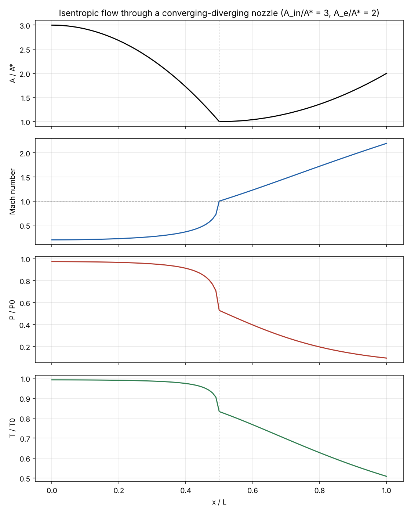

# CFD Projects

Computational fluid dynamics projects written from scratch in Python. I derive the governing equations by hand first, implement them, and then validate against analytical theory or published benchmark data.

I'm Nakul Srivatsan, a mechanical engineering student at Eastern Michigan University, focused on CFD, aerodynamics and compressible flow.

## Projects

| # | Project | Status | Highlights |
|---|---|---|---|
| 1 | [Quasi-1D compressible nozzle flow](01-nozzle-flow) | Complete | Isentropic converging-diverging nozzle solver. Mass flow conserved to 2 × 10⁻¹⁰ %, matches the closed-form choked-flow result and isentropic tables. Geometry also built in SolidWorks and checked against the solver's area ratios. |
| 2 | [2D lid-driven cavity flow](02-cavity-flow) | In progress | Incompressible Navier-Stokes with finite differences. Validation target: Ghia et al. (1982), Re = 100. |

## Approach
- **Physics first.** No CFD frameworks for the core solvers. Each term is derived and discretized by hand before it is coded.
- **Validation built in.** Conservation checks and comparisons to theory are part of each solver, and each README says what the checks do and do not prove.
- **Bugs documented.** Each project records the bugs I hit and how the physics exposed them.

## Background
- White, *Fluid Mechanics* (7th ed.), worked through Ch. 4 (differential relations, vorticity, stream function, exact viscous solutions)
- Barba, *CFD Python: 12 Steps to Navier-Stokes*
- Brunton, ME 564/565 lectures (numerical methods and dynamical systems), in progress
- Coursework: Calculus sequence, Linear Algebra, Differential Equations; Statics in progress

## Tools
Python (NumPy, SciPy, Matplotlib) · SolidWorks and SOLIDWORKS Simulation · MATLAB

## Contact
Srivatsannakul@gmail.com
